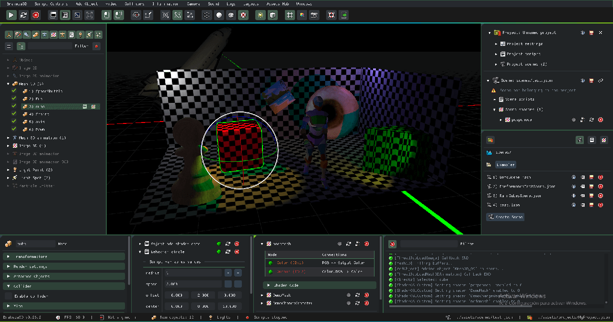
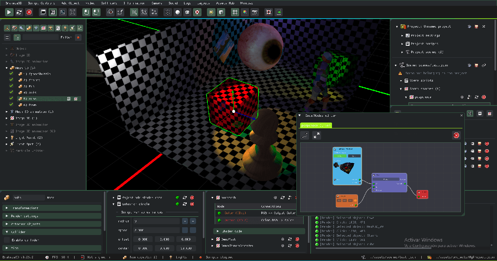
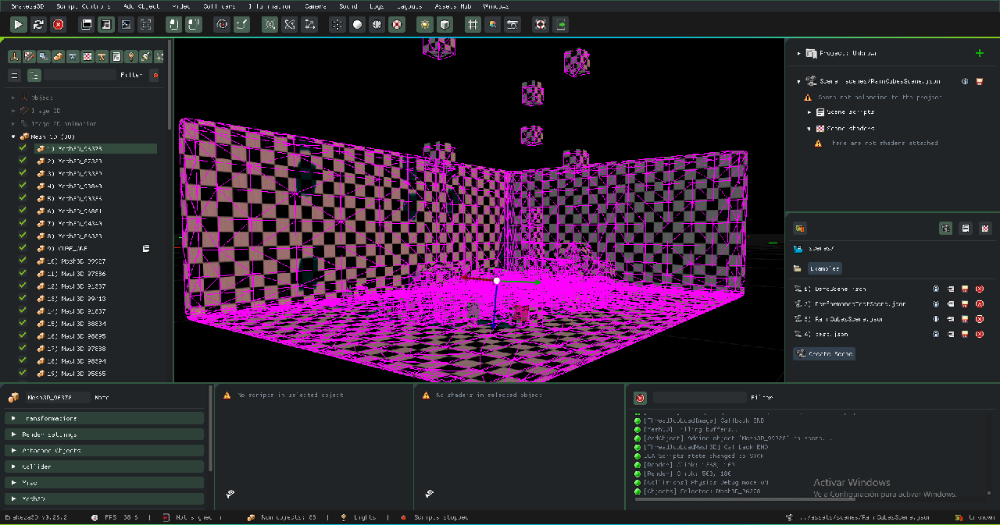
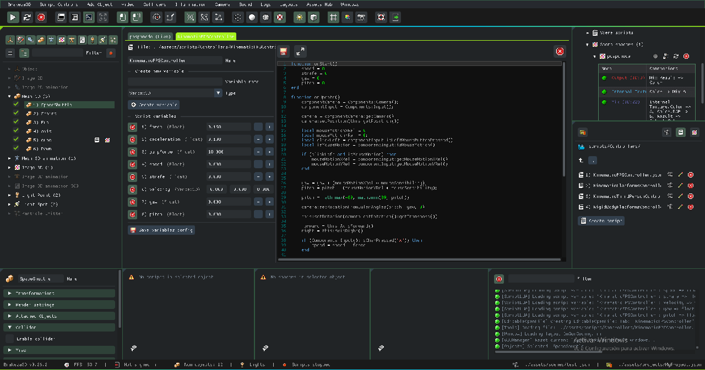
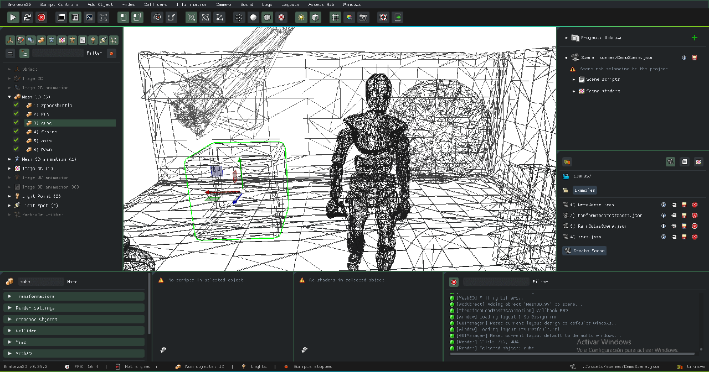
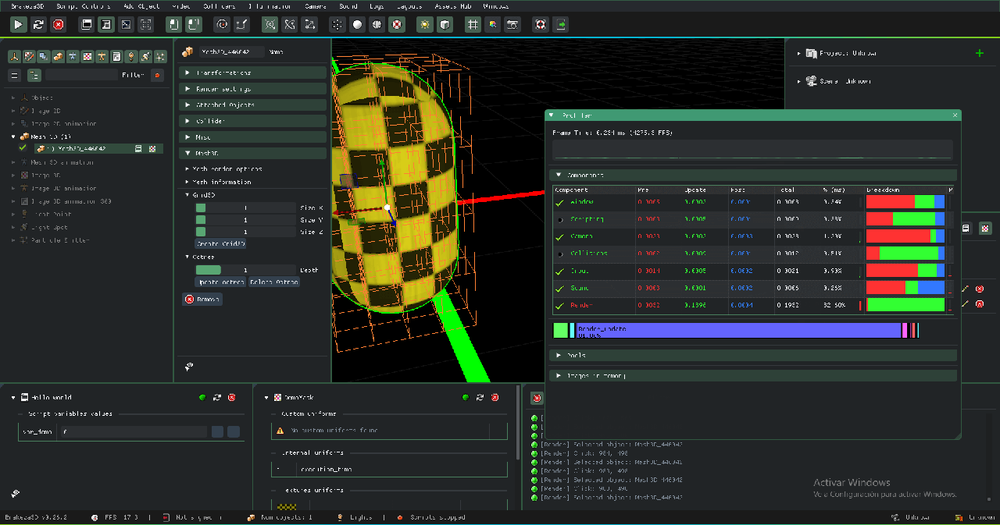
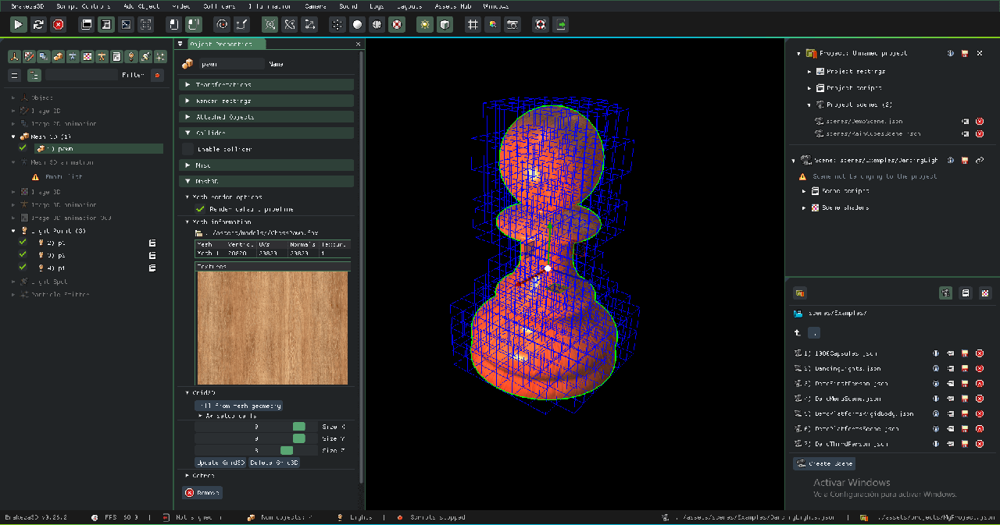

#  Brakeza3D Game Engine

### Free, open source C++ game engine with Lua scripting, deferred OpenGL rendering and an integrated editor

[](https://www.gnu.org/licenses/gpl-3.0)
[](https://github.com/rzeronte/brakeza3d/releases)
[](https://brakeza.com/downloads)
[](https://isocpp.org/)

[🌐 Website](https://brakeza.com) • [📖 Documentation](https://brakeza.com/docs/getting-started/intro) • [⬇️ Downloads](https://brakeza.com/downloads) • [🎨 Gallery](https://brakeza.com/gallery) • [💬 Blog](https://brakeza.com/blog)



**Contents:** [What is it](#-what-is-brakeza3d) • [What you can build](#-what-you-can-build) • [Candelabra](https://brakeza.com/blog/making-of-candelabra) • [AI-friendly](#-ai-friendly-by-design) • [Quick start](#-quick-start) • [Features](#-features) • [Gallery](#-gallery) • [Documentation](#-documentation) • [License](#-license)

---

## 🚀 What is Brakeza3D?

**Brakeza3D** is a free, open-source **2D/3D game engine written from scratch in C++**, designed for flexibility, learning, and complete control over the rendering pipeline. It has a clean, component-based architecture, a **deferred OpenGL 4.3 renderer**, **Lua scripting** with full engine API access, **Bullet physics**, a **node-based shader editor** and a dockable **integrated editor** with real-time preview.

It is made for indie developers and small teams who want to prototype and ship small to medium real-time games quickly, and for anyone who wants an engine they can actually read and understand.

### ✨ Key Highlights

- 🎯 **Dual 2D/3D Workflow**: work with both 2D and 3D content in one engine
- 🎨 **Visual Shader Editor**: node-based shader creation alongside GLSL support
- 📝 **Lua Scripting**: write game logic without recompiling the engine
- 🛠️ **Integrated Editor**: drag-and-drop interface with real-time preview
- ⚡ **High Performance**: deferred rendering, instanced draw calls and shared GPU geometry
- 🤖 **AI-friendly**: text-based projects, a documented Lua API and command-line test scenarios (see [below](#-ai-friendly-by-design))

---

## 🎮 What you can build

- **Prototypes and game jams**: open the editor, drop in a model, attach a Lua script and press play.
- **Strategy and simulation games**: [Candelabra](https://brakeza.com/blog/making-of-candelabra), a city-sized RTS, runs on it.
- **3D action and exploration games** with physics, dynamic lighting, particles and animated characters.
- **Shader and graphics experiments** with GLSL or the node editor.
- **Learning graphics programming**: readable C++ and a documented Lua API let you follow a feature from the script down to the renderer.

Not a replacement for the largest commercial engines: it is the right fit when you want control over the pipeline and a small, understandable codebase.

---

## 🏙️ Made with Brakeza3D: Candelabra

**Candelabra** is a real-time strategy game set in a dark, rain-soaked city carved up between street gangs: civilians, traffic with traffic lights, police reacting to violence, a day/night cycle with weather, and a story on top. It is also the hardest stress test the engine has had, and every time the game needed something the engine could not do, the engine grew a new feature.

- ▶️ [Watch the Candelabra preview on YouTube](https://www.youtube.com/watch?v=_719nP1fJsY)
- 📝 [Making of Candelabra: a city-scale RTS built with Brakeza3D](https://brakeza.com/blog/making-of-candelabra)
- 🛠️ [The RTS Editor: the tool that keeps the game's data standing](https://brakeza.com/blog/rts-editor-tooling)

---

## 🤖 AI-friendly by design

Brakeza3D was not designed around AI, but its choices happen to be what coding agents need:

- **Everything is text**: projects, scenes and game data are JSON, gameplay is Lua, shaders are GLSL. Changes are reviewable in git.
- **A documented Scripting API** and a [`CLAUDE.md`](CLAUDE.md) instruction file describing the architecture and conventions.
- **Fast feedback with Lua**: write a script, run the game, look at the result, with no engine rebuild in the loop.
- **Command-line parameters** (`--set name=value`) that turn the game into a scripted test, and a **built-in profiler** exposed to Lua that writes its numbers to a log.

Read more: [What you can build with Brakeza3D, and using it with AI agents](https://brakeza.com/blog/ai-friendly-game-engine).

---

## 📦 Quick Start

### Pre-built Binaries

Download ready-to-use binaries for your platform:

- **Windows 10/11** (amd64): [Download .exe](https://github.com/rzeronte/brakeza3d/releases/download/0.26.10/Brakeza3D-x64-86-Windows-installer.exe) (220.7 MB)
- **Ubuntu/Debian** (amd64): [Download .deb](https://github.com/rzeronte/brakeza3d/releases/download/0.26.10/Brakeza3D-x64_86-Linux-installer.deb) (92.7 MB)

All releases: [GitHub Releases](https://github.com/rzeronte/brakeza3d/releases) • [Downloads page](https://brakeza.com/downloads)

### Build from Source
```bash
git clone https://github.com/rzeronte/brakeza3d.git
cd brakeza3d
mkdir build && cd build
cmake ..
make
```

📖 **For detailed build instructions, dependencies, and platform-specific guides**, see the [full documentation](https://brakeza.com/docs/getting-started/download-and-install).

---

## 🎯 Features

### 🎨 Rendering & Graphics
- **Forward and Deferred rendering** pipelines
- **Instanced rendering** with shared GPU geometry, including skinned animated models
- **Shadow mapping** with configurable quality
- **ADS lighting system** (Ambient, Diffuse, Specular) with up to 512 point and 512 spot lights
- **Extensible GLSL shaders** + visual node-based editor
- Modern **OpenGL 4.3** (Core profile) rendering

### 🛠️ Development Tools
- **Dockable GUI** with intuitive drag & drop
- **Integrated profiler** for performance analysis
- **Code editor** with syntax highlighting (Lua/GLSL)
- **Scene management** system
- **Real-time preview** in editor

### ⚙️ Core Systems
- **Cross-platform** (Windows / Linux)
- **Multi-threading** support (thread pool based)
- **Physics world integration** (Bullet Physics)
- **Sound system** integration (miniaudio), including 3D positional audio
- **Assimp library** for 3D model loading

### 🎮 Scripting & Input
- **LuaJIT scripting** (Lua 5.2 compatible) with full engine API access
- **Gamepad support** (Xbox / PlayStation controllers)
- Component-based architecture for easy extensibility

---

## 🏗️ Built With

| Technology | Purpose |
|-----------|---------|
| [C++](https://isocpp.org) | Core engine language |
| [SDL2](https://www.libsdl.org) | Window management & input |
| [OpenGL](https://www.opengl.org) | Graphics rendering |
| [Bullet Physics](https://pybullet.org) | Physics simulation |
| [Assimp](https://www.assimp.org) | 3D model importing |
| [LuaJIT](https://luajit.org) | Scripting |
| [ImGui](https://github.com/ocornut/imgui) | Editor interface |
| [GLM](https://github.com/g-truc/glm) | Mathematics library |

---

## 📸 Gallery

<div align="center">

| Editor Interface | Node-Based Shaders | 3D Scene |
|:---:|:---:|:---:|
|  |  |  |

| Lighting System | Physics Demo | Material Editor |
|:---:|:---:|:---:|
|  |  |  |

[View Full Gallery →](https://brakeza.com/gallery)

</div>

---

## 📚 Documentation

- **[Getting Started Guide](https://brakeza.com/docs/getting-started/intro)**: first steps with Brakeza3D
- **[Editor Manual](https://brakeza.com/docs/editor/overview)**: learn the editor interface
- **[Engine Concepts](https://brakeza.com/docs/engine-concepts/script-controls)**: understand core systems
- **[Scripting API](https://brakeza.com/docs/scripting-api/index)**: complete Lua API reference
- **[Advanced Topics](https://brakeza.com/docs/advanced/core-shaders)**: deep dive into engine internals

---

## 🎓 Project Status

Brakeza3D is under **active development** (latest release: [0.26.10](https://github.com/rzeronte/brakeza3d/releases)). Some systems and APIs may change, and certain features are still experimental. The [roadmap](https://brakeza.com/blog/2026-02-21-thanks-and-road-map) puts stabilizing the engine, exposing all of it to Lua and documenting the API first.

**Current suitability:**
- ✅ Learning graphics and engine architecture
- ✅ Rapid prototyping
- ✅ Small to medium real-time projects
- ⚠️ Production-ready games (experimental features)

---

## 🌍 Community

Join the Brakeza3D community and stay updated:

- 🐦 [Twitter](https://twitter.com/brakeza3d): latest news and updates
- 📺 [YouTube](https://youtube.com/@brakeza3d): tutorials and showcases
- 💼 [LinkedIn](https://www.linkedin.com/in/eduardo-rodr%C3%ADguez-1796b8172/): connect with the creator
- 📝 [Blog](https://brakeza.com/blog): development insights
- 🧩 [Assets Hub](https://hub.brakeza.com/): community Lua scripts and shaders

---

## 📄 License

This project is licensed under the **GNU General Public License v3.0 (GPL-3.0)**.

You are free to use, modify, and distribute this software, provided that:
- Derivative works are also licensed under GPL-3.0
- Source code is made available
- Copyright and license notices are preserved

For full details, see the [LICENSE](LICENSE) file or visit [gnu.org/licenses/gpl-3.0](https://www.gnu.org/licenses/gpl-3.0.html).

---

## 💖 Support the Project

If you find Brakeza3D useful, consider:
- ⭐ Starring this repository
- 🐛 Reporting issues or bugs
- 💡 Suggesting new features
- 📖 Contributing to documentation
- 🔧 Submitting pull requests

---

<div align="center">

**Made with ❤️ by [Eduardo Rodríguez Álvarez](https://brakeza.com)**

[Website](https://brakeza.com) • [GitHub](https://github.com/rzeronte/brakeza3d) • [Docs](https://brakeza.com/docs/getting-started/intro)

</div>
