For a while now, most of my time has gone into **Candelabra**: a real-time strategy game set in a
dark, rain-soaked city carved up between street gangs. It is also the hardest stress test Brakeza3D
has ever had. Every time the game asked for something the engine could not do, the engine grew a new
feature.

This post is a tour of how the project came together, with screenshots from the current build.

<!-- truncate -->

  <iframe
    src="https://www.youtube.com/embed/_719nP1fJsY"
    title="CANDELABRA - Preview"
    style={{position: "absolute", top: 0, left: 0, width: "100%", height: "100%", border: 0, borderRadius: "8px"}}
    allow="accelerometer; autoplay; clipboard-write; encrypted-media; gyroscope; picture-in-picture"
    allowFullScreen
  ></iframe>

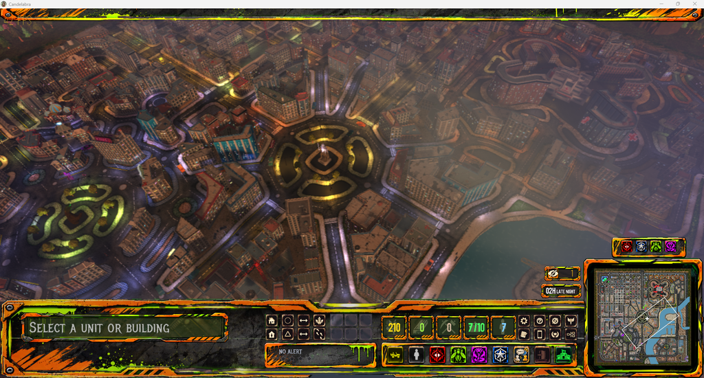

## The idea

Candelabra is a **city-sized RTS**: you start with a handful of units, take over buildings, put workers
to work, research upgrades and push into the districts held by the rival gangs. But the city is not a
static map. Civilians walk the streets, traffic obeys traffic lights, the police react to violence, and
a day/night cycle with weather runs on top of everything.

On top of the strategy layer there is a story. The city wakes up to a body hanging from a crane in the
central plaza, and everybody has a theory. You play **Vicente**, an old pupil of the dead man, and you
have to work out what really happened while four factions fight for the districts. I will not spoil
more than that.

The rule I set from day one: **the game is made with the engine's own tools**, not with a fork of it.
Everything in Candelabra is a scene, a model, a shader or a Lua script that any Brakeza3D user could
also write.

## Why Lua, and how much of the game is Lua

The engine is C++17 and OpenGL 3.3, but almost the entire game lives in **Lua scripts** on top of the
Brakeza3D bridge: the unit state machines, the enemy AI, the building and production queues, the
economy, the quest and dialogue system, the police, the traffic, the HUD.

That is the reason the iteration speed has been good. Change a script, reload, and you are looking at
the result. The C++ side only changed when the game hit a wall: a missing API, or a performance
problem that no script could fix.

## Seeing the whole city at once

The first problem of an RTS set in a real city is **how many things you need to draw**. A top-down view
means hundreds of buildings, cars, props and animated characters on screen simultaneously, plus the
dynamic lights of windows, street lamps and vehicles.

Most of what you read in the [0.26.10 release notes](/blog/brakeza3d-0-26-10) was born here:

- **Shared GPU geometry and instancing**, including skinned characters, because a crowd is the same few
  models repeated many times.
- **Shadow caster culling** per light, so a lamp only pays for what it can actually light.
- **Emissive materials** for neon signs and lit windows that ignore scene lighting.
- **Path costs** for pathfinding, so units prefer streets over cutting through walls.

The deferred renderer does the rest: G-Buffer, ADS lighting with up to 64 point and 64 spot lights, PCF
shadows, and a scene post-processing chain for the grading, fog and rain.

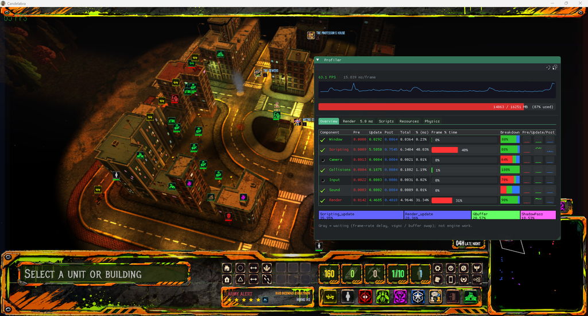

## A living city

The part that surprised me most is how much of the "game feel" comes from systems that are not strictly
the game.

- **Traffic.** Cars follow a directed lane graph with an IDM (intelligent driver model) for
  car-following, traffic lights, and yield rules at intersections. They brake for you if you walk in
  front of them.
- **Pedestrians.** One single manager updates all the decorative civilians, so a thousand people on the
  streets is a matter of budget, not of one script per person.
- **Police and wanted level.** Violence is published on an event bus. Police cars come from the
  station, agents get out and fight whoever caused the trouble, and if you keep escalating, the
  response escalates too.
- **Movement feel.** Units accelerate and brake instead of snapping to speed, avoid each other with a
  predictive separation and smooth their paths, which is a big part of why a group of soldiers looks
  like a group and not like a spreadsheet.

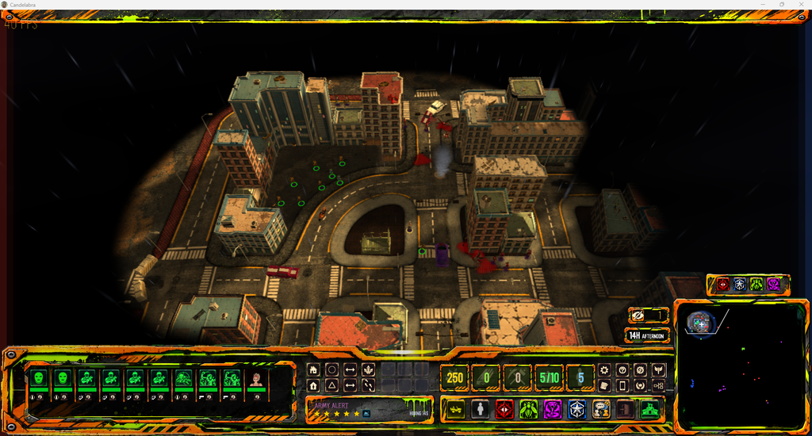

The game starts here: ten units, a fog of war that only reveals what they see, and a city that keeps
going whether you are watching or not.

## Buildings, economy and the tech tree

Buildings are picked straight from the city geometry. Click one and you get its actions, production
queue and rally point.

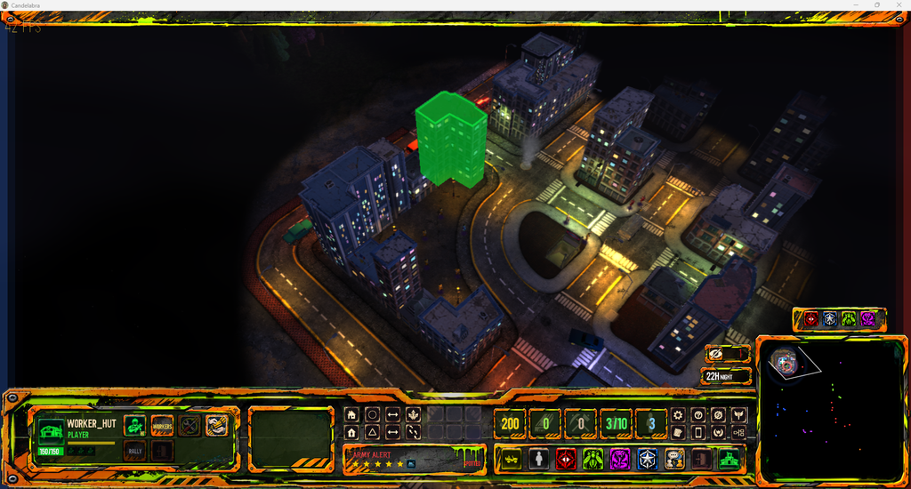

### Acquisition mode

For the bigger picture there is an **acquisition mode**: a management view of the whole city where
buildings are coloured by faction. A panel lists everything you own with its health, another shows the
details of the selected building, and a third lists the neutral buildings in sight. Every row has a
button to jump the camera straight to that building.

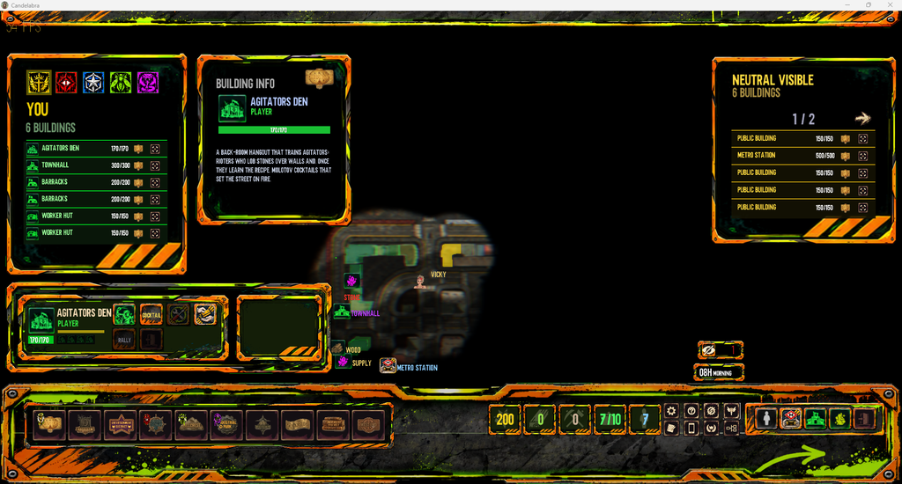

### Places worth a visit

Many buildings can be entered, and each one has its own personality: a casino, a nightclub, a Mexican
restaurant, a strip club. Here are a few of them, seen from outside.

  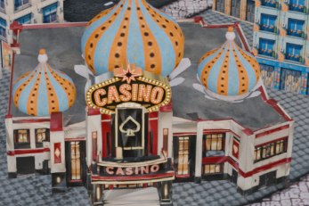
  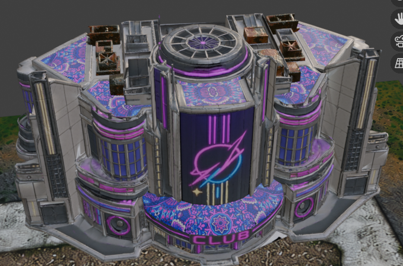
  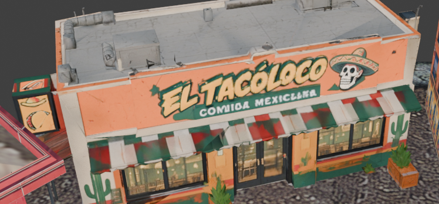
  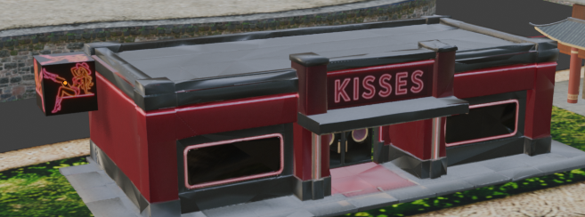

### Tech tree

Resources feed a **tech tree** with eight branches (economy, soldiers, snipers, workers, agitators, the
hero, vehicles and streets). Upgrades chain together, and some unlock new abilities, like the Molotov
cocktails of the agitators or their smoke bombs.

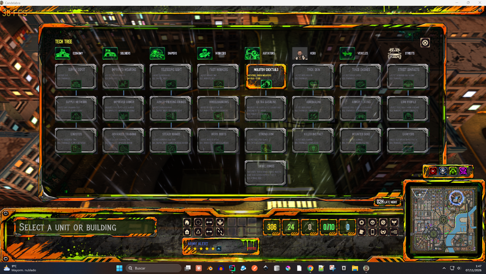

## Characters, dialogue and a story you can talk to

The city is full of people with something to say. Every NPC has a dialogue tree, quests are data files
that the quest manager can chain, and phone messages arrive during the game to push the story forward.
Dialogue scenes are staged with the character portraits and the camera, using the engine's UI widgets.

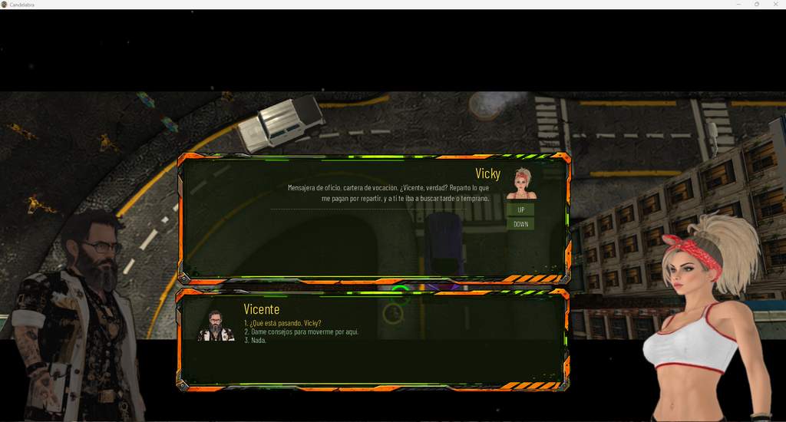

Everything here is **data-driven**: adding an NPC, a quest or a message means editing JSON, not
touching code. That mattered a lot, because writing the lore turned out to be a job as big as the
engineering.

## The UI: widgets, atlases and live themes

The whole HUD (minimap, resource counters, command card, alert panel, clock) is built from the engine's
UI widgets, with the layout stored as JSON and edited inside Brakeza3D.

Its look comes from an **atlas of UI images** that can be re-cut and swapped. I also wired **live UI
themes** and **city styles** that change while the game runs, which is great for experimenting with a
direction before committing to it.

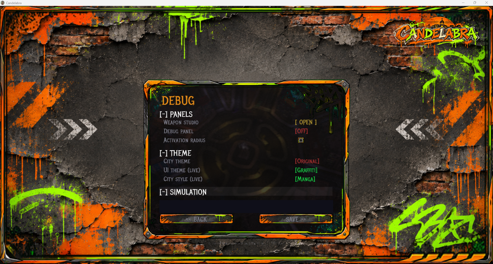

## The Blender pipeline

All the art goes through Blender: the city, the interiors, the vehicles and the characters (with
animations from Mixamo). It used to be a pile of manual steps and every export was a chance to break
something: an object at the wrong scale, an FBX with absolute texture paths, a missing animation.

I replaced it with one script that exports each asset from a preset, backs up the previous file,
validates the FBX and compares it to the old version. Adding a new model to the game is now a
one-liner, and that has been worth more than any optimisation.

## What I learned

1. **Build the game, and the engine follows.** I never had a clear list of engine features at the
   start. I had a game that needed things.
2. **Tooling pays for itself.** The profiler, the in-game debug panels, the weapon studio and the export
   scripts took time to write and saved much more.
3. **Measure first.** Almost every performance hunch I had was wrong, and the profiler was right.
4. **Keep the game in scripts.** It keeps the engine honest: if I cannot do something from Lua, other
   people cannot either.

## What is next

There is still a lot to do: balancing, more districts and interiors, more polish on the story. Many of
the improvements made for Candelabra will keep landing in the engine releases, so everyone using
Brakeza3D benefits.

If you want to follow along, the code is on [GitHub](https://github.com/rzeronte/brakeza3d) and
builds are on the [downloads page](https://brakeza.com/downloads). And if you are building something
with Brakeza3D, I would love to see it.

Thanks for reading!
