*How a single HTML file became the tool that keeps a 27-quest RTS, 35 unit types and 869 translated strings standing, and how I ended up handing it to people who never touch code.*

When people talk about making a game they talk about the engine, the shaders, the physics. Almost never about what takes the most hours: **entering and maintaining data**. In [Candelabra](/blog/making-of-candelabra), the RTS I am building on Brakeza3D, every quest, every dialogue line, every building cost and every unit lives in a JSON file. Editing that by hand works for the first ten days. After that it stops working.

<!-- truncate -->

This post is about the **RTS Editor**: why I built it, what it does today, and what I learned. The thesis is simple: *tools are not a luxury of big projects; they are what lets a project grow without falling apart.*

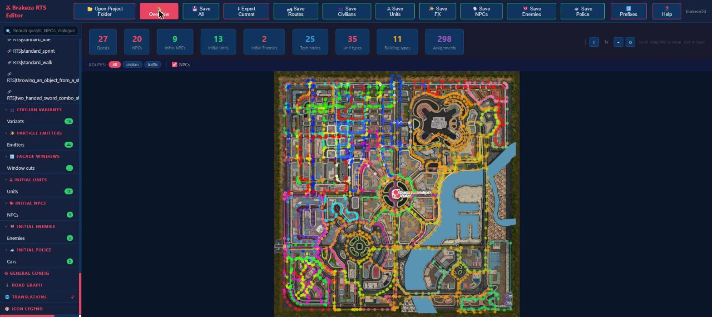

*The start screen: project counters (27 quests, 20 NPCs, 35 unit types, 25 tech nodes, 298 building assignments) and the city map with civilian and traffic routes.*

## The problem: data everywhere

The game reads dozens of JSON files: quests, NPCs and their dialogue trees, unit types, building types, interiors, routes, facade windows, UI text in two languages... The problems show up quickly:

- **Fragile cross references.** A quest mentions an NPC, who mentions a building, which unlocks a technology. A misspelled identifier does not raise an error: the quest simply never completes.
- **Spatial data.** You cannot write the entry point of an interior by eye. You have to *see* it on the map.
- **Size.** With 298 building assignments or 869 strings, searching and comparing by hand is a guaranteed source of mistakes.

## The solution: one HTML file, no server, no install

The editor is **a single page** (about 12,000 lines) that opens in Chrome or Edge. It uses the *File System Access API*: you press "Open Project Folder", pick the project root, and the editor reads and writes the JSON files directly. No backend, no build step, no dependencies.

That has a benefit that is not obvious at first: **what the editor edits is exactly the files in the repository.** There is no intermediate database and no export step. A change in the editor is a change in `git diff`, reviewed and reverted like any other.

It also writes files with exactly the formatting the existing ones have, so saving a file you did not touch produces no diff at all. I checked that round-tripping the existing files is byte-identical, because a tool that adds noise to every commit gets abandoned.

## A tour of the useful parts

### Quests: forms instead of JSON

A quest has objectives, prerequisites, a chain, a time limit and a failure branch. The form knows the objective types (reach a resource amount, kill, talk, enter a building...) and offers only the fields that apply to each. Effects on accept, complete and fail (give resources, unlock a contact, send a phone message, start a call, play a cinematic...) are picked from a list with their own fields. A *JSON Preview* tab shows the exact result.

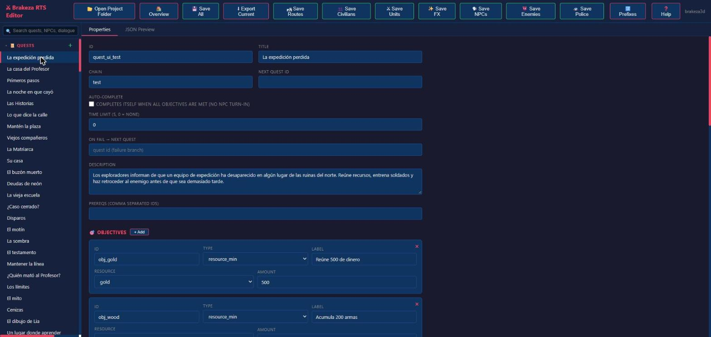

### Dialogues: a graph, not a text tree

Dialogues branch, get locked depending on quest state (the padlock on an option) and loop back. Nested JSON is unreadable; a **node graph** is not. You drag nodes, click an option to jump to its target, and "Auto Layout" tidies everything when the tree gets messy.

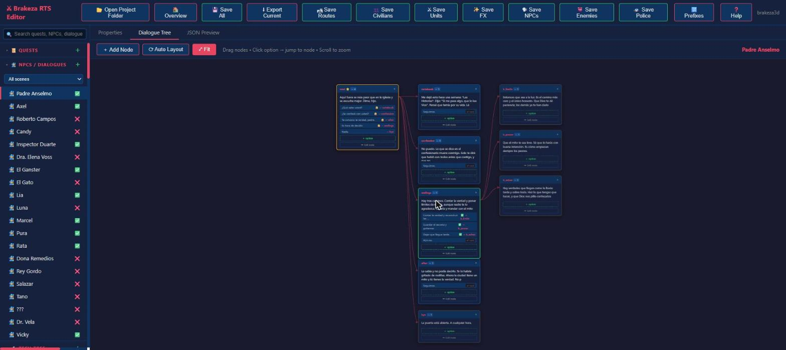

### Tech tree: seeing the dependencies

Each technology has a cost, a required building, prerequisites and unlocks. The *Tree View* tab draws them as a graph, so an orphan node or an over-long chain is obvious at a glance.

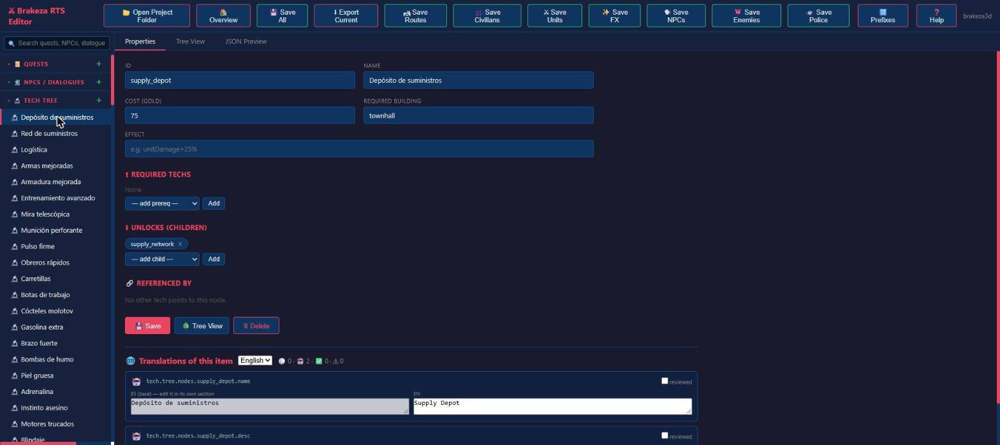

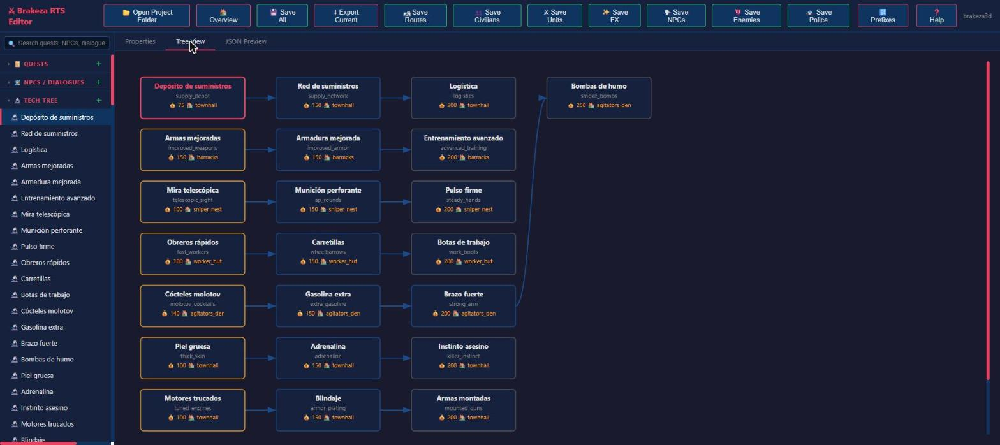

### Interiors: spatial data, on the map

An interior needs an entry point, an exit point, a minimap image and a *pathfinding* image (the green area units can walk on). The editor shows both images next to the fields and lets you drag the points on the map. This is where a visual tool beats editing numbers by a mile. Interior items and their actions (look, take, read, show a photo...) are edited here too.

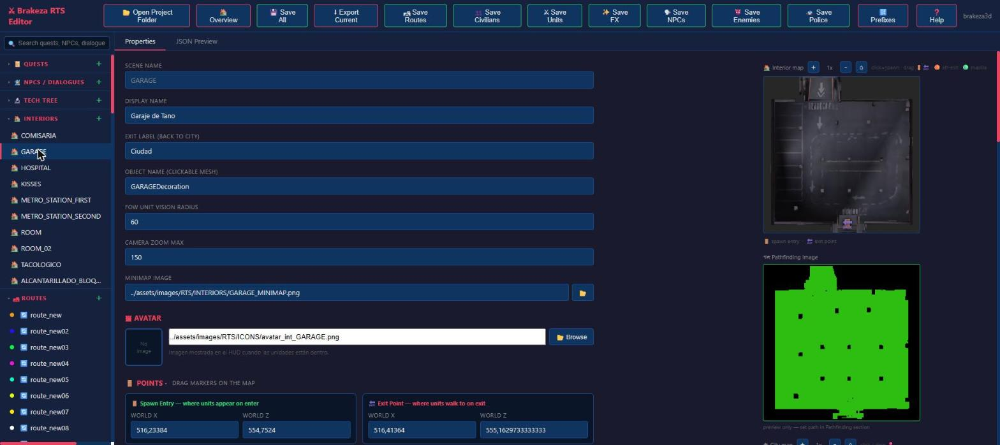

### Buildings and units: balance without touching code

The assignments table links every submesh of the map to a faction and a building type, with filters and bulk edits. The unit sheet gathers damage, range, health, speed, model, script, avatar and lifecycle. Tuning the balance becomes a matter of minutes and needs no recompile.

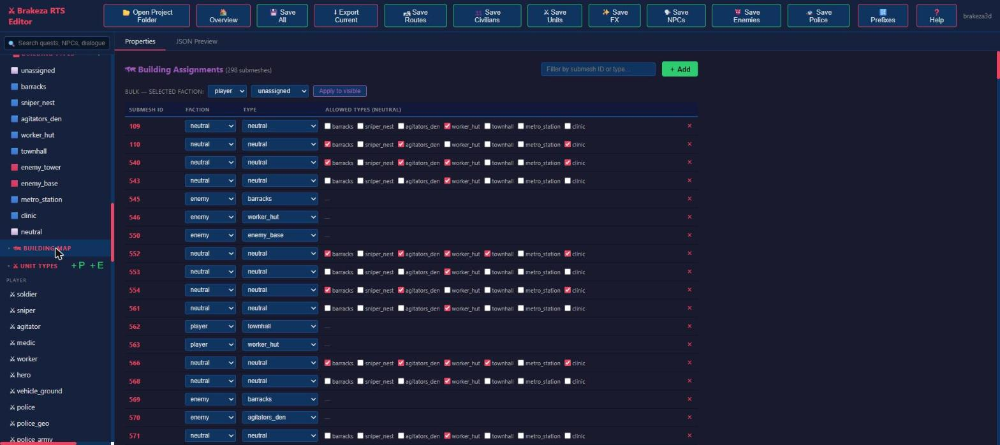

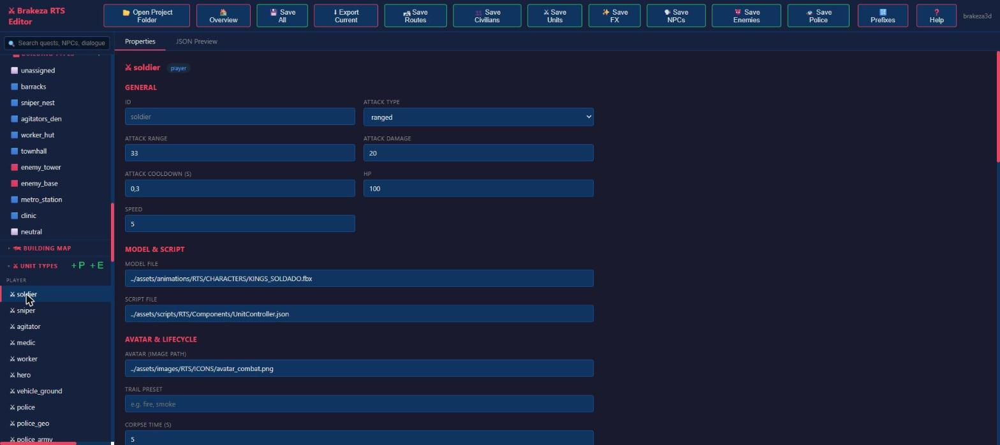

### General configuration

Global parameters (shadows, selection circles, UI scale...) have their own section. The project rule is that **every new parameter goes both into the game's config file and into this screen**, so nobody has to hunt for a constant buried in a `.lua`.

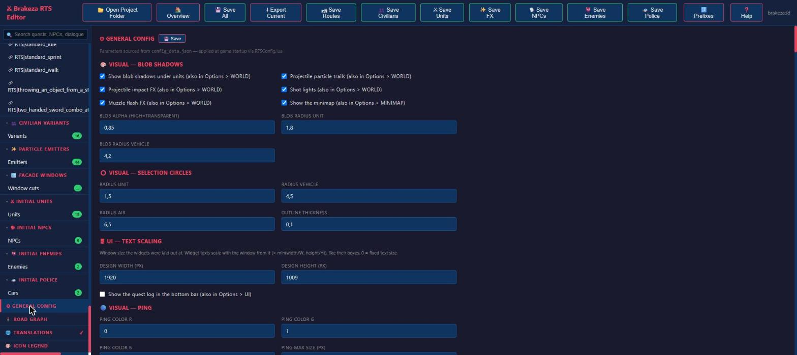

### Translations: 869 strings, two languages

The editor collects every string in the game (dialogues, quests, UI, technologies), shows it in two columns (original and translation), marks each one as pending, machine-translated, reviewed or outdated, lets you filter, and imports and exports CSV to work outside. When you edit the Spanish source text, the English translation of that string flips to *outdated* by itself, so nothing silently drifts out of sync. This is the part that saves the most time and prevents the most mistakes.

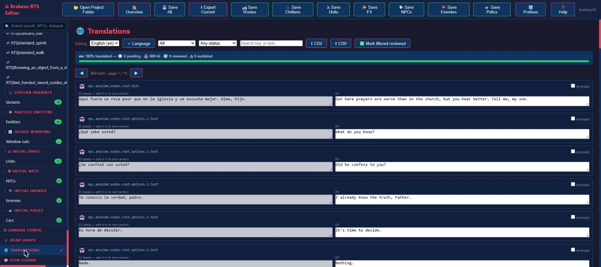

### Road graph

City traffic runs on a lane graph (97 nodes, 419 lanes and 110 crosswalks on the full map). The editor overlays it on the map so you can fix lanes, traffic lights and junctions. It even warns that the city graph is *generated* by a script and that manual changes are lost if it is regenerated: a warning in the exact place where it matters.

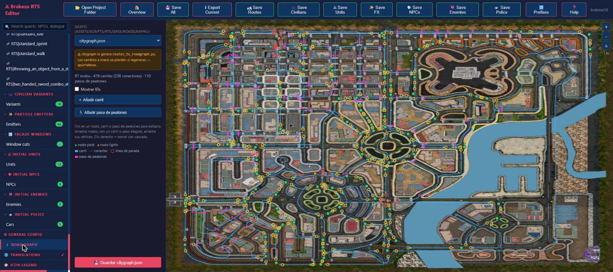

## The latest additions: the story's loose ends

For a long time the editor covered quests, dialogues and numbers, but not the small pieces of text that make a world feel inhabited. Those lived in JSON files you edited by hand, and they were the first thing to get stale. Three new sections fixed that:

- **Calls.** A phone call is a linear dialogue: who rings, whether the incoming-call screen appears, what happens if you decline (drop it, ring again every N seconds with a retry limit, or make it impossible to decline) and the lines. Lines can be reordered, and a call that is never answered can send a "missed call" text message.
- **SMS.** The message catalogue (an id, a sender, the text and the contact it unlocks) and the initial inbox the player starts with.
- **Barks.** The loose phrases NPCs shout on the street, grouped by situation: idle, hero nearby, quest available, quest done.

They share the same data objects as the translations panel, so editing a phrase immediately marks its English version as outdated, and they keep any field the form does not know about when saving. The validator learned about them too: a duplicated SMS id, an inbox entry that points to a message that does not exist, or a quest effect that calls a file that is not there, now show up as warnings before saving.

### Images, without leaving the editor

Lore is also pictures: a photo on a desk, a letter, a portrait. The editor now has an **image manager**: browse the game's images by folder with thumbnails, upload new ones, **replace** an existing one keeping its name (so no reference breaks), delete, and copy the path ready to paste into a JSON file. Before replacing or deleting anything it saves the previous version aside, so nothing is ever lost. Character portraits and the big chat avatars use the same mechanism straight from the NPC sheet.

## Handing it to people who do not write code

The best test of a tool is giving it to someone else. I built a **frozen copy**: one folder containing only the data, the editor and a short guide, with a double-click launcher that opens it in Chrome or Edge, another that zips the work to send back, and an optional checker that finds broken links between quests, dialogues and flags. The people writing the story open the folder in the editor, write, and send me a zip. They never see a line of code, and before every save the editor warns about the things it knows are wrong.

It is a copy on purpose: the story writers work against a snapshot, and I merge their changes by hand. It costs me a few minutes per delivery and it removes any chance of two people overwriting each other's files.

## Safety nets

An editor that lets more people touch the data needs more ways to catch mistakes:

- The editor's own **validator** runs before saving and lists missing quests, unknown effects, unreachable dialogue nodes and the new SMS and call checks above. It warns; it never blocks.
- A standalone **lore checker** walks the whole story: broken links between quests, NPCs and phone messages, flags nobody sets, quests nobody offers or finishes, cycles, and whether there is an ending.
- A **quest simulator** runs the quest logic against a fake engine, so a change that breaks the main chain can fail a test instead of a playthrough.

## What I learned

1. **Build the tool when it hurts, not before and not much later.** The first quest form paid for itself within days.
2. **Edit the real files.** With no intermediate format, version control keeps working and there is nothing to synchronise.
3. **Visual where the data is visual.** Coordinates, graphs and maps are edited by looking at them; text and numbers, with forms.
4. **Keep what you do not understand.** The editor preserves the keys it does not know on save, so a field added by hand or by another system is never lost.
5. **Put warnings where the mistake happens.** A warning on the right screen is worth more than a paragraph of documentation.
6. **Write it down for the next person.** The moment someone else uses the tool, its undocumented conventions become bugs.
7. **It is debt with interest.** The editor needs maintenance too: a new field in the game demands a new field in the editor, and some things are still not covered. Cinematics are still edited by hand, weapons are tuned in a separate in-game weapon studio, and the editor cannot show you how a change *feels* in the game, only that the data is consistent.

## Conclusion

None of this shows up in the trailer, but it is what lets one person with some help keep a game with 27 quests, 20 characters and 869 strings from collapsing. The editor does not make the game better by itself. It makes **iterating cheap**, and that is what ends up making the game better.

If you build a data-driven game, build the editor early, and make it edit the files you already have.
