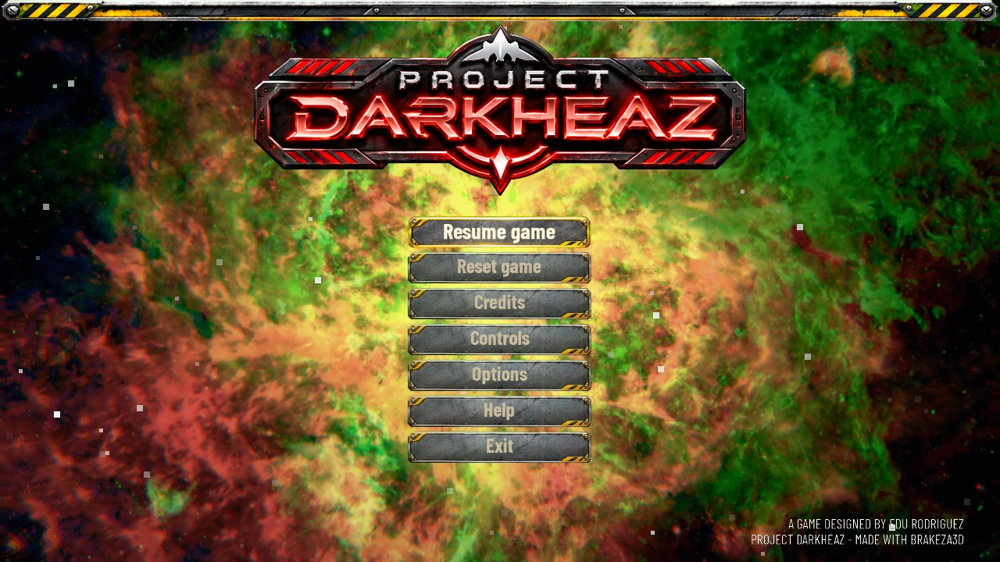
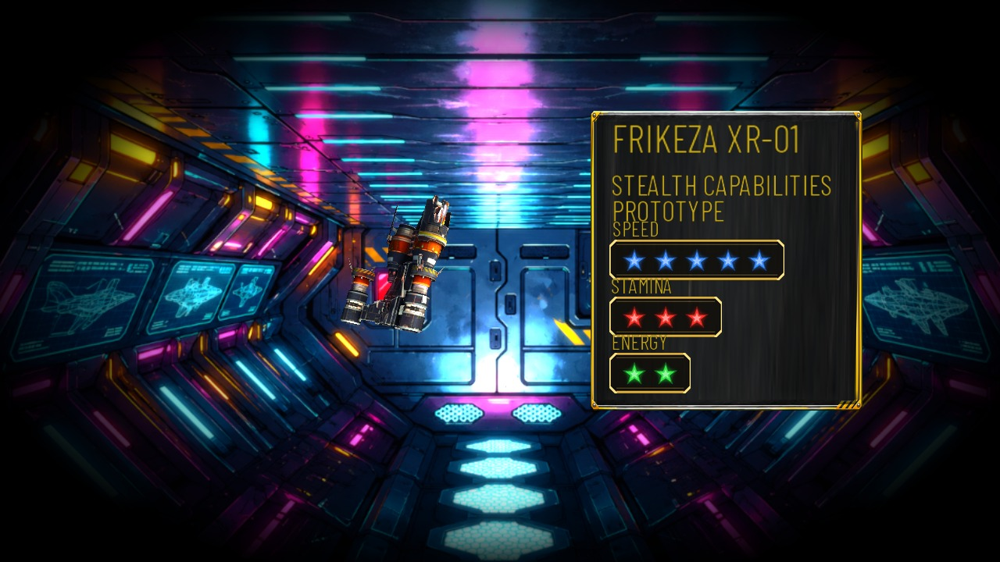
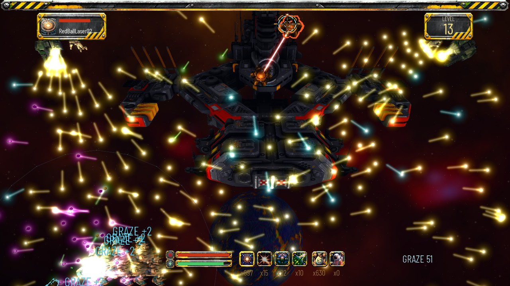
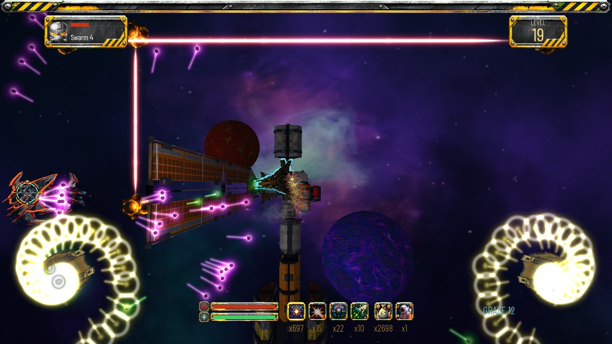

Project DarkHeaZ is my arcade space shooter, built on an earlier version of Brakeza3D. It has always had a special place for me: it was the first game I made with the version of Brakeza that rasterized its pixels in software. That is a big part of why I could not leave it behind.

It had one big problem: it was welded to that old engine. Its game logic lived inside the engine's C++, so every time the engine moved forward, DarkHeaZ stayed behind.

This month I brought it back. It now runs on **Brakeza3D 0.26.10** as a regular engine project written **only in Lua**, without touching a single line of the engine. This post covers how that went, what is new compared to the previous version, and how it performs.

<!-- truncate -->

<iframe
  src="https://www.youtube.com/embed/jVw86U4L6mo"
  title="Project DarkHeaZ, remake built 100% in Lua with Brakeza3D 0.26.10"
  style={{width: "100%", aspectRatio: "16 / 9", margin: "1.5rem 0", border: 0, borderRadius: "8px"}}
  allow="accelerometer; autoplay; clipboard-write; encrypted-media; gyroscope; picture-in-picture"
  allowFullScreen
></iframe>

*Can't see it? [Watch it on YouTube](https://www.youtube.com/watch?v=jVw86U4L6mo). A short intro and then almost four minutes of gameplay across eleven levels, from level 13 to level 48. More on how it was recorded below.*

## Getting it out of the old engine

The first job was understanding the game again. I reverse-engineered the original code into a written specification (weapons, enemy behaviours, level format, the five bosses) and then rebuilt it on top of the current engine's public Lua API:

- **Game logic in Lua**, with a fixed 60 Hz simulation so the original "per frame" formulas keep their feel.
- **Levels stay as data**: the original JSON level format is kept, and the scenery of each level is a separate scene file.
- **Everything else is a project**: scripts, models, sounds and UI live in `projects/DarkHeaZ`, and the engine is used as it ships.
- **It tests itself.** The project accepts command-line parameters (`--set dhTest=level`, `--set dhTest=weapons`, ...) that play a level with a virtual keyboard, write a report and take screenshots. A sweep script plays every level and tells me which ones fail.

That last point is what made the rest of this post possible. Every change below was checked by running levels, not by hoping.

## What changed since the previous version

The first Lua port was faithful but plain. This version is where DarkHeaZ starts to look and feel like a game that belongs on today's engine.

### A new look

- **A new interface** that reuses the *Hazard* theme slots from Candelabra: nine-sliced buttons and frames, a compact HUD centred at the bottom, a target card and a level card in the top corners, and a top bar that slides in and out.
- **A readable typeface**: Barlow Condensed, with lowercase letters, instead of the angular stencil font.
- **Film bars and a staged intro**: the letterbox bars retract slowly at the start of a level and the HUD fades in after them. The game now opens with the Brakeza3D intro video, which you skip with two key presses.
- **Dynamic lighting**: explosions, impacts, muzzle flashes and your own shots now light up the scenery and the ships around them, using a fixed pool of 14 engine lights plus two soft fill lights.
- **Backgrounds and post-processing**: generated nebula backgrounds, a bloom shader that makes the additive beams glow, and a vignette that tightens while you pick a ship.
- **Textures that hold up**: mipmaps with trilinear filtering on the 3D models, a much longer draw distance, and a background plane moved far behind the scenery so distant planets and stations are no longer hidden.

### A different game to play

- **Shots that feel like weapons.** Every shot now has a small random spread, and the fast laser behaves like a machine gun: the spread opens the longer you hold the trigger and it fires two projectiles at once.
- **Enemy bullets that you can see and understand.** Each enemy family has its own shot colour and its own shape (orbs, rings, stars and diamonds), and none of them is green, because green is yours. Continuous beams and barriers are thicker and pulse like yours do.
- **Enemies that move in new ways.** On top of patrol, path and circle patterns there are now figure-eights, zigzags, orbiting the player, lunges that telegraph before they strike, and a *kite* behaviour that keeps its distance.
- **Swarms.** Small ships fly in flocks using the classic boid rules (separation, alignment, cohesion) and scatter when your shots get close. The engine already has a C++ swarm object, but it is not exposed to Lua yet, so these are implemented in Lua with the same rules.
- **Ships that look where they fly.** Models were exported with different "front" directions, so some ships fired out of their backs. There is now a per-model heading correction and a test that lays every model out so the wrong ones are easy to spot.
- **More room to move.** The camera is pulled back so the playable area is about 15% larger.
- **Bullets that disappear when they hit your ship**, instead of crossing the hull.

### Sound

Five new effects fill gaps that were silent: enemy shots, the film bars, the HUD appearing, the countdown and a low-health alarm. They are synthesised by a small script, so they can be regenerated and tuned. An empty-weapon click and sounds that existed but were never played, such as target switching and weapon pickups, are now wired up too.

## Performance

The target is a steady 60 fps at the game's fixed 1280x720 render resolution. I did not benchmark the earlier port, so I will not claim a percentage over it. What I can give are the numbers of this version:

- **The 50-level sweep** (nine seconds of autopilot per level) stays between **58.9 and 59.9 fps** on the development machine.
- **The heaviest scene I measured**, the swarm level, peaks at **246 enemy projectiles on screen** and still holds **about 59.8 fps**.

One thing worth knowing: **all of those numbers are with vsync on**, which is why they sit at 60. That is a cap, not the limit of the game. With vsync off, the same swarm level jumps to **about 320 fps**, and a calmer level goes past **500 fps** on the same machine. So the 60 you see above is the monitor's refresh rate, and there is a lot of headroom behind it.

Why it holds up:

- **Almost nothing is created mid-fight.** Ships, projectiles and effects come from pools, and glow and beam quads are reused every frame and hidden when unused instead of being destroyed.
- **Level of detail by crowd size.** Past 160 enemy projectiles they lose their trails, past 320 only half keep a halo, there is a hard cap of 600, and impact sparks have a per-frame budget.
- **Fewer calls between Lua and the engine.** Each call has a cost, so scale, alpha and rotation are only sent when they actually change.
- **The 0.26.10 renderer does the heavy lifting.** Shared GPU geometry and instanced drawing keep many copies of the same model cheap, which is exactly what a bullet-hell level asks for.
- **A fixed pool of lights**, so the lighting never adds a surprise cost mid-fight.

## About the video

The video above was not played with a keyboard. It was recorded by a pilot script that plays through the game's virtual input, and I wrote it to play like a person rather than a machine: it wanders between points instead of locking onto optimal positions, reacts to bullets with a delay of about a fifth of a second and sometimes misses one, takes its finger off the trigger now and then, switches between the projectile, laser and beam weapons, uses bombs, and holds the energy shield in tight spots.

It also uses the shield items the way they are meant to be used: three times it drops **three shield orbs in a row**, which is the most that can be alive at once, to build a wall in front of a barrage.

The sound effects are rebuilt from the game's own audio log, the real ones mixed at the exact moment they played, and a music track sits underneath them for the whole video.

## What is next

DarkHeaZ now lives in the repository under `projects/DarkHeaZ` and runs with `Brakeza3D -p projects/DarkHeaZ/DarkHeaZProject.json`. Next I want to finish turning the remaining image-based screens into real text, expose the engine's swarm to Lua, and keep going through the later levels, which are the ones that still need the most polish.

If you try it, or if a ship still looks backwards, let me know.

## One more thing: the old video

I also wanted to leave the old footage here, from back when DarkHeaZ was running on the previous version of the engine:

<iframe
  src="https://www.youtube.com/embed/OUuHocFe7yQ"
  title="Project DarkHeaZ, the old video"
  style={{width: "100%", aspectRatio: "16 / 9", margin: "1.5rem 0", border: 0, borderRadius: "8px"}}
  allow="accelerometer; autoplay; clipboard-write; encrypted-media; gyroscope; picture-in-picture"
  allowFullScreen
></iframe>

*Can't see it? [Watch it on YouTube](https://www.youtube.com/watch?v=OUuHocFe7yQ).*

Honestly, it's really nice to watch it now and see how much time has gone by, and how much the game has improved since then. Put the two videos side by side and it's like two different games. I'm pretty happy with how far it's come.
